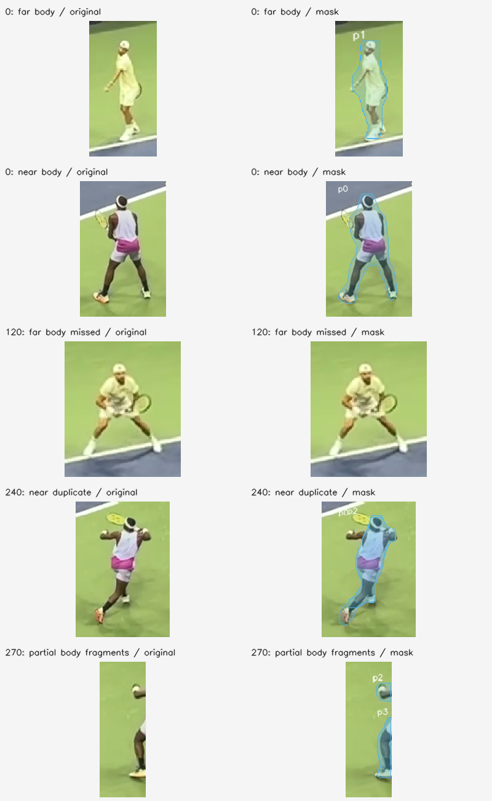

# Optional person-mask diagnostic results

**Decision: retain as an optional developer candidate; do not promote to production.** The official small YOLO11 segmentation graph produces genuine filled body silhouettes and can support a subtle image overlay. The bounded development run also exposes a missed far body, duplicate/fragmented instances, and valid person masks on nonparticipants. It does not close the execution brief's validated, track-linked player-mask milestone.

## Evidence and executed method

The [frozen protocol](PRODUCT_PERSON_MASK_DIAGNOSTIC_2026-10-01.md) used one executed model and one fixed configuration: official YOLO11n-seg ONNX, CPU OpenCV DNN, 640 square RGB input, confidence 0.25, NMS IoU 0.7, native-resolution logit masks and alpha-0.22 overlays. [Publisher asset release](https://github.com/ultralytics/assets/releases/tag/v8.3.0) provenance, digest, pinned source files and license are retained in `artifacts/models/person/segmentation_diagnostic01/`. The code/source review did not show a reason to add SAM 2 before this bounded feasibility check.

The PyTorch asset initially inspected from official v8.4.0 remains **unexecuted** because its static pickle metadata contains `getattr(Detect, 'forward')`. No callable resolver, real `getattr` allowlist, unrestricted deserialization, checkpoint conversion, or gate change was used. The separately published ONNX graph was executed directly. There were no new packages, environment changes, paid resources, or GPU work.

Data are 12 exact original 1920 x 1080 frames from the already-used licensed Dimitrov/Tiafoe development clip: eight pre-existing reviewed frames plus four independently decoded adjacent frames. All original byte hashes passed. This is `DIAGNOSTIC_PRODUCT_DEMO`, `qualification_evidence=false`; approximate body boxes are not pixel-mask ground truth or independently reviewed qualification labels.

The inference command completed with exit zero. An independent static helper review found and fixed the failure-retry guard before protocol freeze, then found no remaining material preprocessing/NMS/native-mask/empty-person defect. The saved masks passed post-run contract checks: 31 uint8 binary masks across all 12 frames, shape/count consistency, finite in-image boxes/confidence, exact area counts, image shape, and all mask/overlay SHA-256 hashes. The frozen helper and note hashes still match their protocol.

## Measured cost

Host: Windows, Intel Core i7-14700HX (`ProcessorNameString` registry observation), Python 3.13.5, OpenCV 4.13.0, NumPy 2.3.1, psutil 7.0.0. Two OpenCV and BLAS threads; CPU only.

| Measurement | Observed value |
|---|---:|
| Model graph load | 0.146 s |
| One warmup, excluded from measured frames | 0.352 s |
| Mean forward inference | 190.6 ms/frame |
| Mean preprocessing + inference + original-resolution masks | 208.0 ms/frame |
| Median complete mask step | 206.9 ms/frame |
| p95 complete mask step | 221.5 ms/frame |
| Complete mask-step throughput | 4.807 FPS |
| Total measured mask steps, 12 frames | 2.496 s |
| Peak process working set | 242,024,448 bytes (242.0 MB / 230.8 MiB) |

FPS excludes PNG/NPZ writes. Memory is the process peak, including artifact creation and retained adjacent-frame masks; it is not a standalone model allocation measurement. The entire CLI took 8.39 s including load, warmup, artifact writes and verification. This CPU result does not establish GPU performance or real-time operation on the 60 FPS source. Background computation/caching remains a product engineering requirement.

## Coverage and qualitative review

| Clip frame | Person masks | Reviewed visible-body box matches with masks | Visible finding |
|---:|---:|---:|---|
| 0 | 2 | 2 / 2 | Both bodies have filled silhouettes; coarse boundary halos remain. |
| 120 | 2 | 1 / 2 | Far visible body missed; near body and back-wall crew masked. |
| 240 | 4 | 2 / 2 | Near body has two overlapping instances; raised arm is incompletely covered. Back-wall crew also masked. |
| 270 | 5 | 1 / 1 | Far body masked; mostly-outside near body split into right-edge fragments. Back-wall crew and a lower-left spectator also masked. |
| 300 | 1 | 1 / 1 | Far body only; no invented mask for the near body outside the image. |
| 360 | 3 | 2 / 2 | Both bodies plus back-wall crew; fine hand/racket boundaries remain unresolved. |
| 480 | 3 | 2 / 2 | Both bodies plus back-wall crew; coarse foot boundaries. |
| 540 | 3 | 2 / 2 | Both bodies plus back-wall crew; distant extended hand/racket region incompletely covered. |

In total, 13 of 14 visible-body boxes have a matching mask-bearing box at IoU at least 0.5. Six of 32 explicit nonparticipant boxes match mask-bearing boxes: all six are back-wall crew. These counts describe label-assisted **box coverage with a nonempty mask**, not mask IoU, mask accuracy, active-player precision, or exhaustive detector false positives. Crew and spectator masks are valid all-person detections but unacceptable automatic participant promotion. The frame-270 partial body remains excluded from full-body localization scoring.

I visually inspected all 12 overlays and a five-case original/overlay crop sheet. Masks follow bodies and spaces between the legs; they are not rectangular exclusion masks. No standalone court/net patch was visibly returned as a person mask in this bounded sample. The contours are visibly coarse, may include nearby background at edges, and can lose extended arms/hands. The near frame-240 body has duplicated tint from overlapping instances. None of this establishes boundary precision or foot localization improvement.

The four adjacent frames 309–312 produce a far-body mask and a back-wall-crew mask in each frame. Six mutual box associations have unwarped mask IoU 0.867–0.965 and area ratio 0.971–1.025. Visual appearance is reasonably consistent over this tiny interval. The scores include real body/camera movement and a static crew person; there is no pixel ground truth, optical-flow compensation, or identity supervision. They are descriptive proxies, not a validated flicker or tracking metric.

## Remaining gates

The overlay is feasible as a developer image preview. Production still needs independently reviewed near/far pixel masks and difficult occlusion/edge cases; a stable participant/identity association; duplicate/fragment handling; missing/low-confidence display behavior; meaningful labeled temporal mask stability; measured intended-runtime costs; cache/background processing and a user toggle; and public/proprietary deployment license review. A separate baseline and labeled contact points are required before claiming foot localization, participant filtering, or pose visibility gains. The invalid court still prohibits world-coordinate or speed claims.

No production pipeline, product analysis result, participant label, or frontend file was changed by this work. The diagnostic does not produce a public demo or new scientific qualification evidence.

## Artifact locations

- `artifacts/validation/product_execution/person_mask_diagnostic02/protocol.json`: SHA-256 `9f5e3ba6fcf465338fbbc3c57d3c35882375a995bae6a0c65da2fc0f0055a0ac`.
- `artifacts/validation/product_execution/person_mask_diagnostic02/report.json`: SHA-256 `f2617a57576bd3d60c216e93d5e39a8820357056323a4d28f1a913d9359d0270`.
- The same directory contains all 12 original-resolution overlays, 12 safe NumPy mask archives, four independently decoded original PNGs, `boundary_review.png`, `review_artifacts.py`, and `artifact_integrity.json`.
- `scripts/evaluate/diagnose_product_person_masks.py`: optional bounded helper; refuses to overwrite a completed/failed inference revision.
- `artifacts/validation/product_execution/person_mask_diagnostic01/prepare_failure.json`: preserves the initial zero-free-disk failure and the incomplete original PNG. No model had loaded at that failure. Disk subsequently recovered without this agent deleting shared artifacts; revision 02 preserves the failed revision rather than replacing it.

